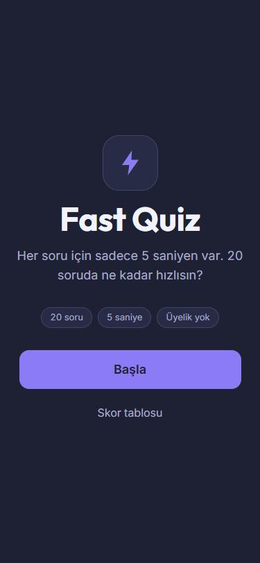
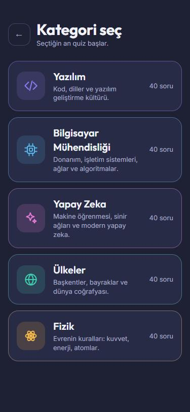
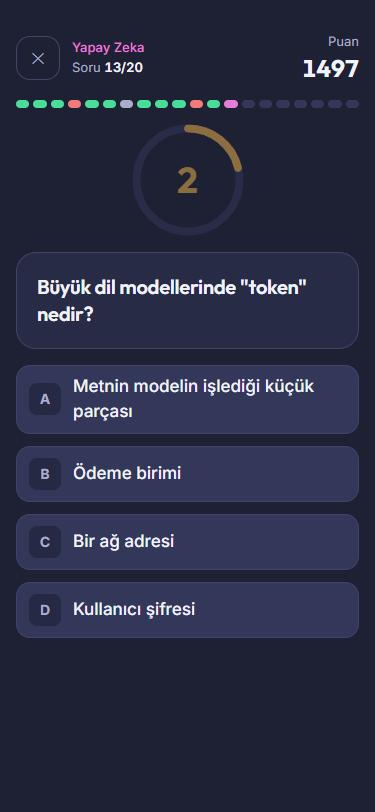
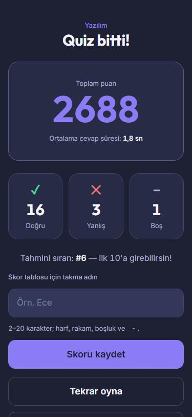
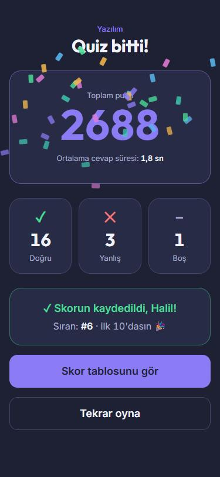
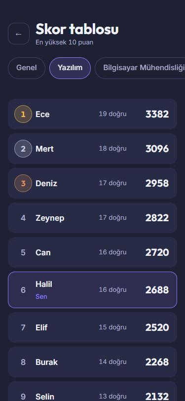

# Fast Quiz — Frontend

[](https://github.com/Voynichh/FastQuizFrontend/actions/workflows/ci.yml)


[](LICENSE)

**Fast Quiz**, her soruyu **5 saniyede** cevapladığın, üyeliksiz bir bilgi yarışması oyunudur: bir kategori seç, 20 soruyu yanıtla, puanını gör, takma adını yaz ve skor tablosunda yerini al.

Bu repo oyunun **mobil öncelikli web arayüzüdür** (Vue 3 + TypeScript). Tüm kurallar (süre, puan, sıralama) sunucuda işler; arayüz yalnızca ekranı çizer. API: **[FastQuizBackend](https://github.com/Voynichh/FastQuizBackend)**. Aynı kod daha sonra Capacitor ile iOS/Android'e paketlenecek.

<p align="center">
  
  
  
</p>
<p align="center">
  
  
  
</p>

## Öne çıkanlar

- **Sunucuya güvenen sayaç:** `useCountdown`, `deadline − server_time` farkıyla bitişi hesaplar (cihaz saati yanlış olsa da şaşmaz), `requestAnimationFrame` ile akıcı çalışır; süre dolunca `choice_id: null` gönderir.
- **Dayanıklı quiz akışı:** `useQuizSession` durum makinesi (yükleniyor → geri sayım → soru → geri bildirim → hata); çift tıklama kilidi, ağ hatasında tek otomatik yeniden deneme, kaybolan yanıtta sunucu durumuna yeniden senkronizasyon, sayfa yenilemede kaldığı yerden devam.
- **Tipli API:** Backend'in OpenAPI şemasından (`openapi/schema.yml`) `openapi-typescript` ile üretilmiş tipler; tek axios istemcisi ve tek hata tipi.
- **Erişilebilirlik odaklı arayüz:** WCAG AA hedefli kontrast, ≥44 px dokunma alanı, görünür odak halkası, doğru/yanlış yalnızca renkle değil ✓/✕ ile de gösterilir, klavyeyle oynanır (`1–4` / `A–D`), `prefers-reduced-motion` desteği (konfeti ve animasyonlar kapanır).
- **Tema sistemi:** Tailwind CSS 4 `@theme` ile tek yerden renk/yazı tipi tokenları; kategori rengi API'den token adı olarak gelir ve quiz boyunca tekrar edilir.
- **Skor tablosu:** Genel + kategori sekmeleri (URL'de tutulur), madalya rozetleri, kendi skorunu vurgulama, yarış durumuna karşı korumalı yükleme.
- **Güvenlik:** `v-html` ESLint kuralıyla yasak; kullanıcı metni her zaman metin olarak basılır.
- Çıkış onayı (✕ ve tarayıcı geri tuşu), animasyonlu puan sayacı, ilk 10'a girince konfeti.

## Teknoloji

| | |
| --- | --- |
| Çatı | Vue 3.5 (Composition API, `<script setup>`), Vue Router 5, Pinia 4 |
| Dil / araçlar | TypeScript 6, Vite 8, Tailwind CSS 4, Axios |
| Test | Vitest 5, Vue Test Utils, jsdom · **128 test** |
| Kalite | ESLint 10 (flat config), Prettier, `vue-tsc`, GitHub Actions |

## Hızlı başlangıç

Önkoşullar: Node.js ≥ 24 ve çalışan backend ([kurulum](https://github.com/Voynichh/FastQuizBackend#hızlı-başlangıç): `docker compose up --build`).

```bash
cp .env.example .env     # VITE_API_BASE_URL=http://localhost:8000/api/v1
npm install
npm run dev              # http://localhost:5173
```

> Windows PowerShell'de `npm run dev` "running scripts is disabled" hatası verirse `npm.cmd run dev` kullan.

## Komutlar

```bash
npm run test           # birim ve bileşen testleri (Vitest)
npm run lint           # ESLint
npm run type-check     # vue-tsc
npm run format:check   # Prettier
npm run build          # üretim derlemesi (dist/)
npm run gen:api        # openapi/schema.yml → src/types/api.d.ts
```

API şeması değişirse backend reposunda `python manage.py spectacular --file ../FastQuizFrontend/openapi/schema.yml` çalıştırıp `npm run gen:api` ile tipleri yenile.

## Proje yapısı

```
src/
├── api/            axios istemcisi, uç noktalar, hata tipi
├── components/     CategoryCard, TimerRing, ProgressBar, ChoiceButton, ScoreCounter, NameForm, ...
├── composables/    useCountdown, useQuizSession
├── stores/         Pinia: quiz (oturum, soru, skor, kalıcılık)
├── views/          Home, Categories, Quiz, Result, Leaderboard, NotFound
├── lib/            storage soyutlaması, platform, doğrulama, biçimleme
├── styles/         Tailwind tema tokenları
└── types/          üretilmiş API tipleri
tests/              birim, bileşen ve akış testleri
docs/PROJECT.md     başlangıç proje dokümanı
```

## Yol haritası

- [x] Web arayüzü: kategori → quiz → sonuç → skor tablosu
- [ ] Mobil uygulama (Capacitor ile iOS/Android; aynı kod ve aynı API)
- [ ] Ses efektleri ve titreşim (varsayılan kapalı)
- [ ] Playwright ile uçtan uca testler

## Lisans

[MIT](LICENSE)
